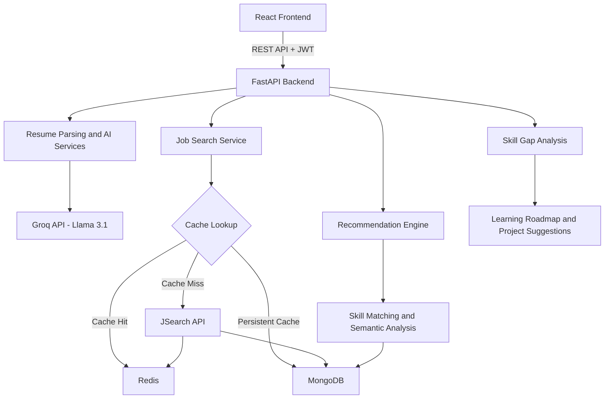

# Context-Aware Job Recommendation & Skill Gap Analyzer

An AI-powered career guidance platform that analyzes resumes, recommends relevant job opportunities, explains job-match scores, and identifies missing skills with personalized learning roadmaps.

The platform combines **LLM-based resume parsing, semantic job matching, skill gap analysis, and multi-layer caching** to help job seekers make informed career decisions while minimizing unnecessary external API calls.


**Live Demo:** http://15.206.100.29

---

## Table of Contents

- [Overview](#overview)
- [Problem Statement](#problem-statement)
- [Key Features](#key-features)
- [How It Works](#how-it-works)
- [System Architecture](#system-architecture)
- [Technology Stack](#technology-stack)
- [Key Engineering Decisions](#key-engineering-decisions)
- [Results](#results)
- [Getting Started](#getting-started)
- [Application Workflow](#application-workflow)
- [API Usage Optimization](#api-usage-optimization)
- [Project Structure](#project-structure)
- [Future Improvements](#future-improvements)
- [Author](#author)

---

## Overview

Finding a suitable job involves more than matching keywords on a resume. Candidates often struggle to identify roles aligned with their existing skills and understand what they need to learn to qualify for better opportunities.

This project addresses these challenges through an integrated AI-powered workflow. Users upload their resumes, explore relevant job openings, receive personalized recommendations, and discover skill gaps along with actionable learning resources.

The platform also suggests portfolio projects tailored to a candidate's profile, helping bridge the gap between existing capabilities and job requirements.

## Problem Statement

Traditional job recommendation systems often rely heavily on keyword matching. This can overlook related skills, contextual relationships, and transferable experience.

The platform aims to improve this process by:

- Extracting structured candidate information from resumes.
- Matching candidate profiles with relevant job requirements.
- Explaining why a job is recommended.
- Identifying missing skills and prioritizing learning needs.
- Reducing repeated external API calls through caching.

## Key Features

### 1. AI-Powered Resume Parsing

Users upload a PDF resume, and an LLM extracts relevant information into structured JSON, including:

- Skills and technical competencies.
- Education and qualifications.
- Professional experience.
- Contact and profile information.

The extracted information becomes the foundation for personalized recommendations.

### 2. Personalized Job Recommendations

The platform compares candidate profiles against available job listings and ranks suitable opportunities using match scores from 0 to 100.

Each recommendation includes an explanation of the match and identifies skills that may be missing from the candidate's profile.

### 3. Skill Gap Analysis

For a selected job, the system identifies:

- Skills the candidate already possesses.
- Skills required by the job but missing from the profile.
- A readiness score based on the skill comparison.
- Prioritized learning recommendations and relevant resources.

This helps candidates understand the steps needed to become better suited for a particular role.

### 4. Personalized Portfolio Project Suggestions

The platform considers whether the user is a student or a working professional and suggests three tailored project ideas.

Each suggestion includes a recommended technology stack and implementation steps intended to help address identified skill gaps.

### 5. Live Job Search with Multi-Layer Caching

Job listings are retrieved through the JSearch API and cached across Redis and MongoDB.

- Redis provides fast access to recently requested searches.
- MongoDB persists job listings for reuse.
- The external API is queried when neither cache contains the requested search results.

### 6. Secure Authentication

JWT-based signup and login provide authenticated access to the application's user features.

### 7. Direct Job Application

Each job card includes an **Apply Now** button that directs users to the relevant application page when an application URL is available.

---

## How It Works

The platform follows a sequence of steps that transforms an uploaded resume into personalized career recommendations.

### Step 1: Resume Upload and Parsing

The user uploads a PDF resume through the React interface. The backend extracts its text and sends the relevant content to the configured LLM.

The LLM identifies skills, education, experience, and other profile information, returning a structured representation that can be stored and reused.

### Step 2: Job Discovery and Data Caching

When a user searches for jobs, the backend checks the available caches:

1. **Redis:** Checks for a recent search result.
2. **MongoDB:** Checks for previously stored job data.
3. **JSearch API:** Retrieves external results if the requested data is not found in either cache.

Newly retrieved results are stored for future requests.

### Step 3: Candidate–Job Matching

The recommendation engine compares the candidate's skills and experience with job requirements.

The matching process combines exact skill and alias matching with semantic reasoning to recognize relevant relationships between skills and job descriptions.

Jobs are ranked by their match scores, and the system generates explanations to help users understand the recommendations.

### Step 4: Skill Gap Identification

Once a candidate selects a job, the platform compares the required skills with the candidate's existing profile.

The result includes matched skills, missing skills, a readiness score, and a suggested learning roadmap. A deterministic comparison provides a fallback if the AI-based analysis cannot be parsed successfully.

### Step 5: Personalized Career Development

Using the identified skill gaps, the system proposes learning resources and portfolio projects that can help candidates build relevant skills and demonstrate their capabilities.

The recommendation and skill-gap workflows use stored job data, avoiding additional JSearch API calls for these operations.

---

## System Architecture

The application uses a React frontend connected to a FastAPI backend through REST APIs. The backend coordinates the AI services, authentication, job retrieval, and data storage.



### Job Search Flow

The caching strategy checks Redis first, followed by MongoDB, and calls JSearch only when the requested results are unavailable in both.

Redis entries use a six-hour TTL. MongoDB provides persistent storage so that data can remain available after Redis entries expire.

### Recommendation Flow

The recommendation engine works with cached job listings and the candidate's parsed profile. It performs skill matching and generates personalized recommendations without requiring another external job-search API request.

---

## Technology Stack

| Layer | Technologies |
|---|---|
| Programming Language | Python 3.11+ |
| Backend | FastAPI, Uvicorn |
| Frontend | React, Node.js |
| AI and LLMs | Groq API, Llama 3.1, Hugging Face Transformers, Sentence Transformers |
| Vector Search | Pinecone, ChromaDB |
| Databases | MongoDB, Redis |
| External API | JSearch API via RapidAPI |
| Authentication | JSON Web Tokens (JWT) |
| Deployment | AWS |

## Key Engineering Decisions

### 1. Multi-Layer Caching to Reduce API Usage

External job-search APIs can have request limits and usage costs. To reduce repeated requests, the application uses Redis for fast retrieval and MongoDB for persistent job data.

This allows repeated searches to reuse stored results instead of repeatedly querying the external service.

### 2. Reliable LLM Output Handling

LLMs can return malformed JSON or unexpected output. The AI service layer therefore uses defensive parsing and fallback logic.

- Extracts JSON from responses that may contain Markdown formatting.
- Uses deterministic skill comparisons if AI-based skill gap parsing fails.
- Uses low-temperature settings for structured parsing and scoring tasks.
- Limits resume text and job-list sizes to control prompt length and token usage.

### 3. Multi-Domain Retrieval

Early retrieval experiments showed that overemphasizing one domain could reduce relevance for candidates with diverse technical skills.

The retrieval workflow was redesigned around multi-domain query decomposition to improve coverage across different skill areas.

### 4. Two-Layer Skill Matching

The matching system combines two approaches:

- **Exact and alias matching:** Identifies directly matching skills and known variations.
- **Semantic matching:** Uses language-model reasoning to recognize related skills and contextual similarities.

Combining these approaches aims to balance fast, precise matching with broader semantic understanding.

---

## Results

The project notes report the following improvements from development and evaluation:

| Metric | Reported Result |
|---|---|
| Resume parsing accuracy | Approximately 30% improvement over a keyword-matching baseline |
| Job-match relevance | Approximately 35% improvement after retrieval redesign |
| External API calls | Zero additional JSearch calls for cached searches, recommendations, and skill gap analysis |

*Note: These figures should be retained only if supported by your actual evaluation results. Clearly document the baseline, test dataset, and measurement method when presenting them as measured improvements.*

---

## Getting Started

### Prerequisites

Install the following before running the project:

- Python 3.11 or later
- Node.js 18 or later
- MongoDB
- Redis (optional)

You will also need API credentials for the configured Groq and JSearch services.

### 1. Clone the Repository

```bash
git clone https://github.com/ayushraj059/YOUR-REPOSITORY.git
cd YOUR-REPOSITORY
```

Replace `YOUR-REPOSITORY` with the actual repository name.

### 2. Set Up the Backend

```bash
cd backend

python -m venv venv
```

Activate the environment.

**Windows:**

```bash
venv\Scripts\activate
```

**macOS/Linux:**

```bash
source venv/bin/activate
```

Install dependencies:

```bash
pip install -r requirements.txt
```

### 3. Configure Environment Variables

Create a `.env` file inside the `backend/` directory.

```env
GROQ_API_KEY=your_groq_api_key
JWT_SECRET_KEY=your_secure_random_secret
RAPIDAPI_KEY=your_rapidapi_key

MONGO_URI=mongodb://localhost:27017
REDIS_HOST=localhost
REDIS_PORT=6379
```

Generate a secure JWT secret using:

```bash
python -c "import secrets; print(secrets.token_urlsafe(32))"
```

Never commit API keys, JWT secrets, or other credentials to version control.

### 4. Start the Database Services

Start MongoDB using the service manager or installation-specific instructions for your operating system.

If Redis is configured, start it as well. Redis is optional according to the project configuration, although its absence may reduce performance.

### 5. Run the Backend

From the `backend/` directory:

```bash
uvicorn main:app --reload --port 8000
```

Open the interactive API documentation:

http://localhost:8000/docs

### 6. Run the Frontend

Open a separate terminal:

```bash
cd frontend
npm install
npm start
```

The frontend is expected to be available at:

http://localhost:3000

*Follow the commands in your actual project configuration if your frontend uses Vite or another development server.*

---

## Application Workflow

1. **Create an account:** Register and log in.
2. **Upload a resume:** Submit a PDF through the profile page.
3. **Search for jobs:** Browse available job listings.
4. **Explore recommendations:** View jobs ranked against your profile.
5. **Analyze skill gaps:** Select a job to identify missing skills and readiness.
6. **Build a learning plan:** Review suggested resources and portfolio projects.
7. **Apply for jobs:** Use the application link provided on each job listing.

## API Usage Optimization

| Operation | Expected JSearch API Calls |
|---|---:|
| First search for an uncached query | 1 |
| Repeat search while Redis entry is valid | 0 |
| Search after Redis expiry when MongoDB has the results | 0 |
| Job recommendations using cached listings | 0 |
| Skill gap analysis using cached listings | 0 |

These counts assume that the requested data is available when the caches are checked and that the search operation requires only one external request on a cache miss.

---

## Project Structure

```text
.
├── backend/
│   ├── main.py
│   ├── requirements.txt
│   └── .env
├── frontend/
│   ├── src/
│   ├── public/
│   └── package.json
└── README.md
```

The structure above is illustrative. Update it to reflect the actual files and directories in your repository.

## Future Improvements

- Automated tests for AI services and API endpoints.
- Docker Compose for simplified local setup.
- Rate limiting for LLM-powered endpoints.
- Resume improvement suggestions tailored to a target job.
- More extensive evaluation of matching relevance and recommendation quality.

## Author

**Ayush Raj**  
B.Tech, Computer Science and Engineering  
SRM Institute of Science and Technology

- [GitHub](https://github.com/ayushraj059)
- [LinkedIn](https://www.linkedin.com/in/ayush-raj-3a1bb82b0/)
- Email: ayushraj5019@gmail.com
